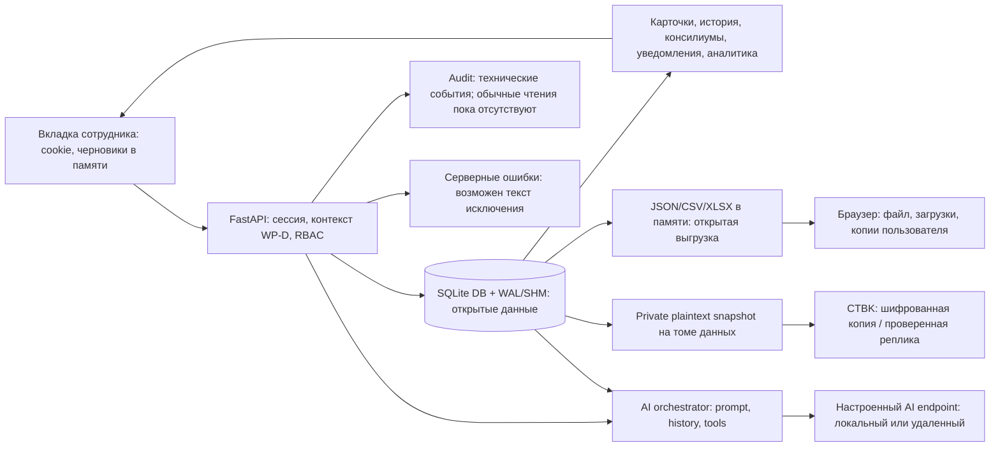

# Clinic Tracker — WP-G: архитектурное предложение

Дата: 30.10.2026. Статус: **исследование завершено; требуется решение владельца до реализации**.

Репозиторий: приватный `IskhakovMA/fixes`. База и текущий HEAD: `4042ebacaa75a661b45bf768ece5eea27100e856`. Созданы отдельная ветка `fix/wp-g-privacy-ai-security` и worktree `/Users/maksutishakov/Documents/Projects/clinic_tracker_wp_g`. Production-код, схема v29, аутентификация, медицинский аудит и внешняя передача не изменены. Коммит/push/PR/merge/deploy не выполнялись.

## 1. Что фактически подтверждено

Исторический CLINIC_TRACKER_FULL_AUDIT.md рассмотрен по AUD-25/26/27/28/43 и связанным границам; сопоставлены THREAT_MODEL.md, OPERATIONS.md, RBAC_DESIGN.md, актуальный код и тесты. Фактическое состояние 4042eba имеет приоритет. Это исследование WP-G, не повторный полный аудит и не заявление о закрытии перечисленных AUD.

| Пункт | Подтверждение на базе | Что уже защищено / граница вывода |
| --- | --- | --- |
| AUD-25: адрес назначения | Конструктор AI-провайдера принимает произвольный HTTPS-host, HTTPS loopback, link-local и private IP. Allowlist нет. `_probe_provider()` не вызывает даже `_require_safe_transport()`. DNS/IP назначения не закрепляются за проверенным соединением | Проверка конструктора не выполняла внешних запросов. HTTP non-loopback обычно запрещен в chat, но есть AI_ALLOW_INSECURE_TRANSPORT. Redirects запрещены и в chat, и в health; реальная loopback-проверка подтвердила отсутствие перехода |
| AUD-25: содержимое | Tool-results содержат ФИО и постоянный patientId; summary — профиль, ответственного сотрудника и этап; timeline — даты/вид лечения; attention — свободный comment. Orchestrator передает tool-result модели, в том числе повторно с историей текущего запроса. Пользовательский message/history могут содержать любые введенные ПДн | Нет механизма псевдонимизации/отдельного разрешения внешней передачи. Телефон/полис/диагноз намеренно отсутствуют в проверенном summary/search DTO, но это не обезличивание и не фильтрация свободного ввода |
| AUD-27: успешные чтения | Настоящий FastAPI: список пациентов, карточка, analytics summary и consilium appointments возвращают 200 без новой audit_events строки. Карточка выдается даже при искусственно запрещенном INSERT в audit_events | Экспорты JSON/аналитики/XLSX уже записываются fail-closed до выдачи; отдельные duplicate/backdating views также имеют обязательный аудит. Переписывать эту защиту нельзя |
| AUD-27: отказы | Врач не видит /api/audit (403), чужая карточка скрыта (404), но в исследованном сценарии audit_events не пополнился access_denied | Доступ защищен; дефект — отсутствие достаточного следа отказа, а не доступ к чужой карточке. Другие маршруты уже используют best-effort ACCESS_DENIED |
| AUD-26: открытые данные | Подписанный JSON-export содержит синтетические ФИО и C34.1 открытым текстом. SQLite не шифруется приложением; DB/WAL содержат читаемые данные | Подпись экспорта обеспечивает целостность/происхождение, не конфиденциальность. Portable CTBK backups уже шифруются; криптографию WP-B/WP-F менять не требуется |
| AUD-43: остатки | Соединение production `_connect()` на отдельной синтетической SQLite показывает secure_delete=0. После INSERT/checkpoint/DELETE тестовой строки маркер находится в DB и WAL, SQL уже возвращает 0 строк | Проба использует отдельную scratch-таблицу, не обход клинических триггеров и не доказательство разрешенного удаления защищенной истории. В WP-C часть истории намеренно неудаляема |
| AUD-28: idle | last_seen_at выставляется при входе, но не обновляется validate_session. Синтетическое last_seen_at 30 дней назад при еще действительном expires_at не мешает медицинскому GET (200) | Абсолютный TTL действует, сессии отзываются при изменении учетной записи; WP-D проверяет идентичность/полномочия и сохраняет черновики отдельно |
| AUD-28: пароль/MFA | Минимум 8 символов и список из 12 слабых значений; `abcdefgh` проходит validate_password_strength. Argon2 и лимиты входа есть. Рабочего второго фактора сотрудников нет | enrollment_state patient portal и его проверки — не реализация MFA сотрудников. Лимитер входа in-memory/per-process, перезапуск сбрасывает состояние |
| Логи в рамках WP-G | Искусственное ValueError с синтетическим PHI-marker попадает в logger.exception основного обработчика; HTTP 500 сам маркер не раскрывает | Это проверка возможной утечки текста исключения, не заявление, что все штатные ошибки уже содержат ПДн. AI success-log пишет технические user_id/role/время/число calls, не prompt |

### Исследовательские проверки

Только временные синтетические SQLite/FastAPI TestClient; для транспорта — настоящий HTTP-server на 127.0.0.1 со stub-ответом. Внешние DNS/AI-запросы, рабочая база и production не использовались.

- `test_research.py`: **9 passed**. Это characterization-пробы, подтверждающие текущее поведение/риски, а не доказательство исправления.
- `test_additional.py`: **2 passed, 1 failed**. Неуспешное утверждение требует access_denied после двух запрещенных чтений; фактически 0. 403/404 и неразглашение имени в HTTP подтверждены до этого утверждения. Красная проба сохранена как доказательство дефекта, не исправлялась изменением production и не перезапускалась ради зеленого результата.
- Существующие AI/transport/session/WP-D-context/freshness/audit: **74 passed**.
- Существующие backup CLI плюс две проверки неизменности истории WP-C: **7 passed**.
- Первый внешний исследовательский harness ошибочно ожидал 200 вместо фактического штатного 201 при создании пациента (3 failed/5 passed); ожидание исправлено на точный 201. Второй смешанный запуск внешнего pytest-plugin с repo conftest остановился на дублирующей регистрации до тестов; внешние и существующие проверки затем запущены раздельно. Оба исходных журнала сохранены. Это ошибки подготовки проб, а не retries падающего backend-набора. Skip/xfail и ослабления существующих тестов не добавлялись.

Материалы: `/Users/maksutishakov/Documents/Projects/wp_g_research_evidence/`. Исходный полный набор 2157 подтвержден закрытием WP-F; заново все 2157, Staff-UX/CSP/CI-policy/scanners и браузеры на исследовательском этапе не прогонялись. Для измененного WP-G полный набор будет обязателен после согласования и реализации.

## 2. Карта потоков медицинских данных

Основные пути инвентаризации: `/api/patients` и карточка/attention/portal-access/архив событий; `/api/consilium` appointments/schedule/revisions/registries/analytics/backdating; `/api/analytics/*` включая details/export; data-quality, duplicate registry/reasons; внутренние/пациентские уведомления и их previews; `/api/export`; `/api/ai/chat` и tool-функции. Метаданные без медицинских значений отделяются от чувствительных результатов по фактическому DTO, не только по URL. Получение списка уже является раскрытием, даже если отдельная карточка не открывалась.

Границы: процесс/память браузера; аутентифицированный API; файловая система/аккаунт сервиса; оператор обслуживания/допуск WP-F; получатель файла; AI-процесс и его storage/logging/оператор; внешняя сеть/прокси. Локальный AI — отдельная граница доверия, а не автоматическое разрешение использовать реальные ПДн. Шифрованный том не защищает данные от работающего процесса с разрешенным доступом. UUID и медицинские агрегаты остаются чувствительной связуемой информацией; слово «анонимный» для них не использовать.

## 3. Предлагаемая граница ИИ — решение G1

Рекомендуется **G1-A: внешняя передача выключена по умолчанию и недоступна до отдельного утверждения владельцем модели передачи**. Для разработки — только явный synthetic/local-stub режим. Удаленный провайдер не выбирается. Автопоиск localhost не должен автоматически означать допуск реальных медицинских данных.

Разделить три разрешения: включение AI-функции, допуск конкретного назначения и разрешение конкретной категории минимизированного payload. Одно AI_ENABLED не дает остальных разрешений. Нельзя сохранить AI_ALLOW_INSECURE_TRANSPORT как обход для удаленных медицинских запросов. Старую внешнюю конфигурацию при rollout блокировать с безопасной причиной, а не молча продолжать.

Предлагаемый транспортный контракт:

1. Allowlist полных нормализованных origins (scheme/ASCII hostname/port) и фиксированного API-prefix. Только HTTPS для remote. Reject userinfo, fragment, query base URL, неоднозначные escape/Unicode/числовые IP-представления, wildcard/suffix match и произвольные URL из prompt/tools. Не сравнивать startswith или endswith.
2. Все A/AAAA проверяются по допустимому адресу: reject loopback/private/link-local/unspecified/multicast/reserved и IPv4-mapped обходы для remote. Внутренний локальный stub — отдельный режим, не исключение remote allowlist. Если часть DNS-ответов запрещена — отказ целиком.
3. Проверка DNS должна быть привязана к фактическому соединению: соединение с проверенным IP при сохранении исходных hostname/SNI/проверки TLS-сертификата. Простое resolve → urllib.open(hostname) не устраняет rebinding. Проверять каждый новый connection/повтор/tool round; не доверять только health cache. Не включать автоматические retry POST. Учитывать IPv6 и смену DNS между запросами.
4. Redirects оставить запрещенными на health/chat. Health/status проходит тот же gate до отправки bearer key. Не наследовать произвольные HTTP(S)_PROXY из окружения для AI; если управляемый egress-прокси необходим, его доверие и разрешенные назначения согласуются отдельно. Без безопасного транспорта remote остается выключенным; нельзя ослабить TLS для тестов.
5. Ограничить request/response bytes, число tools/rounds, время и параллельность; существующие лимиты сохранить. Endpoint/model/key и payload не выводить в API/логи; ошибки — фиксированные коды. Неразрешенное направление блокируется до DNS/сети. Действующая фильтрация ответа модели не заменяет фильтрацию исходящего запроса.

### Контракт минимизации — требует согласования

Ввести **отдельный AI DTO**, а UI DTO и пациентские ссылки оставить на сервере. Внешней модели не передавать displayName, телефон/полис/email, ФИО сотрудника, постоянный patientId, свободные notes/comments/history пользователя. Для выбранных разрешенных инструментов использовать случайный alias на один запрос/короткую беседу; таблица alias→ID только в памяти сервера, привязана к user/session/access-context. Никаких глобально устойчивых псевдонимов. Tool argument alias не дает прав: каждый вызов заново проверяет серверный scope; неизвестный/чужой alias — отказ без сведений о пациенте. UI references восстанавливаются сервером после проверки.

Перечень допустимых клинических полей/точность дат/агрегатов утверждается владельцем отдельно. Псевдонимизированные клинические данные не считать анонимными. Для стартового режима без внешнего разрешения рекомендуются только локальные шаблоны операционных вопросов и synthetic stub, без отправки клинических значений наружу.

Свободный ввод — существенная нерешенная часть: regex-замена ФИО не обеспечивает обезличивание. Варианты: **A** для remote только структурированный набор запросов/полей, без message/history; **B** свободный текст лишь после отдельного утверждения обработки и проверенного механизма минимизации. Рекомендуется A; это изменение AI-контракта и возможностей, поэтому сейчас не реализовано. Запрещено молча переслать исходный текст при ошибке фильтра.

Аудировать разрешенное получение данных инструментом и отдельную попытку внешней передачи до сети, без payload. Перед tool-read и перед возвратом конечного AI-ответа заново проверять сессию/полномочия. На время сетевого вызова SQLite write-lock не держать. При отзыве прав отбросить ответ, aliases и ссылки. После состоявшейся отправки отзыв не может забрать данные у провайдера — поэтому допуск передачи проверяется непосредственно перед отправкой.

## 4. Единый аудит чтений — решение G2

Предлагаемый семантический контракт: **сначала долговечно фиксируется разрешение выдачи конкретного snapshot, затем данные покидают сервер**. Событие не обещает, что клиент получил/прочитал ответ. Не писать «успешно просмотрено» после разрыва сети. Export WP-C уже использует близкую модель; не создавать для него второй дублирующий event.

Поля: server UTC timestamp, event_id/request_id, actor_user_id/role и актуальный scope stamp, операция из allowlist, тип/технический ID объекта, outcome (`release_authorized`, `denied`, `error`), безопасный reason-code, число выданных объектов, версия/тип snapshot при необходимости. Ни ФИО, ни диагнозов, поисковых строк, текста истории, cookie/token/CSRF, prompt или полного URL/query. При 401 субъект может быть unknown; не доверять присланному X-Clinic-User без действительной сессии. Для чужого ID не раскрывать в ответе существование объекта.

### Варианты массового чтения

| Вариант | След | Стоимость/ограничение |
| --- | --- | --- |
| G2-A: event на каждого пациента | Точный перечень простой моделью | N inserts/events на загрузку; для 10 000 карточек — 10 000 событий; повышает contention/индексы/retention |
| G2-B: один batch-event + точный manifest технических IDs | Кто получил какой snapshot/набор; 1 event и 1 manifest на ответ | O(N) байт остается; manifest сам чувствителен и защищается теми же правами/retention. Рекомендуется |
| G2-C: один event + count/фильтр/digest | Малый объем | По mutable-фильтру или одному digest нельзя надежно восстановить точный набор; слабее расследование |

Рекомендуется **G2-B**: отдельный append-only read manifest связан с event_id в той же транзакции; фиксируется canonical список технических IDs/типов и count/digest, без значений медицинских полей. Ограничить размер сериализованного manifest до выдачи, не усекать молча; порог — техническая конфигурация после измерений. Существующие непагинированные списки требуют нагрузочной оценки; UI-пагинацию/редизайн в этот пакет не добавлять автоматически. Если безопасный лимит нарушает текущие рабочие объемы, отдельно согласовать контракт пагинации.

Иллюстрация, не измерение production: UUID в JSON порядка 35–40 байт; 10 000 IDs дают примерно 0.35–0.40 MB без SQLite/index overhead. При 1000 таких ответов/сутки — примерно 350–400 MB/сутки только manifest. Число parent-events меньше N-events, но рост данных все равно существенный. До rollout измерить p50/p95, WAL size, lock-wait и объем на синтетических 100/1000/10000 записей; утвердить capacity/retention. Не активировать автоматическое удаление.

Транзакционная схема короткого чувствительного read: взять необходимый короткий write-lock, перечитать актуальные сессию/scope, сформировать разрешенный snapshot, вставить audit+manifest, commit; только затем вернуть JSON/bytes. Ошибка любой стадии — rollback/503 без медицинского тела. Не удерживать транзакцию во время сети, генерации большого файла или передачи клиенту; для тяжелого экспорта подготовить snapshot и повторно проверить контекст/его актуальность перед фиксацией release. Нужна явная граница snapshot, иначе audit и выданный набор расходятся. Это план, окончательная реализация проверяется конкурентными тестами.

Для отказов: одна запись в централизованном верхнем access-wrapper с outcome denied; нижний policy/tool возвращает типизированную причину, не пишет повторную строку. Уже существующий обязательный event маршрута является владельцем записи; общий слой помечает его обработанным. Внутренние составные вызовы не создают повторов для тех же выдаваемых данных. Два отдельных HTTP-запроса — два события, даже если клиент повторил загрузку. У AI отдельные tool-rounds/передачи — отдельные границы раскрытия, correlation одним request_id.

При отказе самой БД нельзя гарантировать запись отказа в эту же БД: данные все равно не выдаются, возвращается безопасный 503/401, технический сигнал мониторинга не содержит payload. Ошибку аудита не скрывать best-effort успешным ответом. Не журналировать каждую health/static/status probe как медицинское чтение; флуд неаутентифицированных запросов отдельно ограничивается. Точный учет rejected reads и защита от audit-flood требуют нагрузочного теста, не lossy дедупликации медицинских событий.

Журнал/manifest доступны только текущему can_view_audit (сейчас разработчик), без нового права врача/заведующего; просмотр самого чувствительного журнала — отдельное событие без рекурсии. Технические IDs не анонимны. Срок хранения read events/manifest должен быть согласован: действующий общий retention 365 дней и минимальный порог 30 дней не являются автоматически утвержденной политикой для нового массива. Согласовать совместное удаление manifest/event с сохранением удерживаемых WP-C событий; не менять существующие триггеры для упрощения.

## 5. Диск, временные файлы и списание — решения G3/G4

Сохранить AES-GCM CTBK WP-B/WP-F, pending/permit и offline verify. Не вводить SQLCipher/новую криптосистему. Обязательное эксплуатационное требование: зашифрованный том для DATA_DIR, SQLite DB/WAL/SHM/journal, private diagnostic/backup/restore snapshots, swap/hibernation/core dumps и всех копий/снапшотов. Для macOS/Linux выбрать подтверждаемые владельцем FileVault/полное шифрование Linux-тома и custody ключей, не включать их автоматически. Проверка приложения не доказывает шифрование всех слоев хранения; нужен проверяемый акт конфигурации хоста/носителя.

Существующий maintenance создает private TemporaryDirectory рядом с базой, plaintext snapshot остается на томе данных, внешний каталог получает шифротекст; finally удаляет временные файлы. XLSX формируется в BytesIO, JSON/CSV возвращаются из памяти; это не защищает browser Downloads, swap или копии пользователя. После SIGKILL finally не гарантирован; нужны инвентаризация orphan-temp, offline исключительные блокировки, проверка разрешенного имени/типа/владельца и отсутствие symlink перед отдельной подтвержденной очисткой. Не удалять WAL/SHM или файлы recovery/pending по маске. Планируемый тест: убить процесс на snapshot, подтвердить остаток/права и безопасную процедуру; в текущем исследовании этот сценарий заново не выполнялся.

Технические меры на согласование: secure_delete=ON для обычных удаляемых SQLite строк; проверка влияния на I/O и совместимость; лимиты/temp_store для временных вычислений после нагрузочной оценки; регулярное обслуживание WAL только штатной offline-процедурой. journal_size_limit не является очисткой живого WAL и не гарантирует стирание. VACUUM/checkpoint меняют файлы и должны уважать WP-F: если добавляется такая команда обслуживания, она фиксирует pending до мутации и требует offline verify; не запускать ее из startup/health. Сначала проверить, что необходимость обусловлена реальными остатками и политикой хранения, а не менять DB ради флага.

**Удаление строки, secure_delete, VACUUM, TRUNCATE WAL и unlink не гарантируют физическое стирание SSD, snapshots, резервных копий и клиентских выгрузок.** Опасную формулировку OPERATIONS «гарантированное удаление конкретного пациента: удалить → VACUUM → пересоздать копии» заменить после согласования: это только логическая очистка подконтрольных экземпляров, при наличии права на удаление и отсутствии обязательного хранения медицинской истории.

Процедура вывода носителя/экземпляра: (1) согласовать основание/retention/удержание, владельца и перечень всех DB/WAL/temp/export/backups/snapshots/replicas; (2) остановить доступ и обслуживание, сохранить обязательные записи и проверенный recovery, если он необходим; (3) выбрать подходящий для носителя подтверждаемый sanitize/purge/crypto-erase или физическое уничтожение по утвержденной процедуре; crypto-erase допустим только при доказанной полноте шифрования и уничтожении всех доступных экземпляров ключа; (4) отдельно учесть резервные копии, key escrow и внешние snapshots; (5) верифицировать результат доступным методом, получить акт с идентификатором носителя/методом/временем/оператором/проверяющим без ПДн; (6) после восстановления из старой копии повторно применять согласованные запреты/удаления, иначе данные вернутся. Стратегия такого реестра ограничений требует отдельного решения, сейчас не реализована. Не уничтожать медицинскую append-only историю и не обходить триггеры WP-C.

## 6. Сессии и пароли — решения G5/G6

### Idle timeout

| Вариант | Плюсы | Последствия |
| --- | --- | --- |
| Все аутентифицированные запросы обновляют last_seen | Простой серверный источник времени | Background polling делает сессию практически бессрочно активной до absolute TTL |
| Только явные действия сотрудника / разрешенные интерактивные запросы | Соответствует неактивности человека; рекомендуется | Нужна карта активности и небольшой контракт клиента, polling/status не продлевают срок |
| Жесткий короткий absolute TTL вместо idle | Простота | Не решает именно inactivity и мешает работающему сотруднику; не рекомендуется как замена |

Период владельцу на выбор: например 5 минут для общих терминалов, 15 минут как умеренный вариант, 30 минут для длительной работы; **ни одно значение не выбрано и не активировано**. Существующий absolute TTL 8 часов сохранить отдельным верхним пределом, если владелец не утвердит иной. Нужен выбор: общая активность cookie-сессии всех вкладок (рекомендуется) или отдельный tab-lock поверх сессии. Серверный idle не скрывает уже нарисованную карточку сам: клиент должен блокировать UI по полученному deadline и при возвращении вкладки проверять сервер до показа/запроса; это расширение согласуется с WP-D.

Предлагаемая серверная семантика: UTC-время сервера; `now >= min(expires_at, last_activity_at + idle)` — истекла, без возможности воскресить запросом. На boundary сперва проверить срок, потом обновить last_activity_at атомарно с MAX(старое, now), не удлиняя expires_at. Не брать время из тела запроса. При откате системных часов — безопасный отказ/сигнал, не отрицательное idle. Настройки проверяются на положительный технический диапазон, не допускают отключающего bypass. Конкурентные запросы не уменьшают timestamp; фоновые probes не поддерживают активность. Сессию после expiry удалять/отзывать безопасно.

Для медицинской записи проверять актуальную сессию и полномочия повторно под write-lock, а не только в зависимости FastAPI до ожидания. Для длительного AI/чтения повторно проверить перед раскрытием результата. Определить линейную точку авторизации внутри транзакции; завершенная до истечения операция не аннулируется задним числом. Использовать управляемые UTC-часы и явные barriers в тестах, включая exact boundary, rollback часов, expiry во время lock/AI и вкладки.

WP-D сохраняется: 401 блокирует медицинский UI, повторный вход получает свежие права и карточки; черновик хранится отдельно с исходной версией, без автозаписи; старый черновик при ручном сохранении получает 409; отзыв доступа удаляет карточку/черновик; смена identity в другой вкладке аннулирует старые ответы/черновики. Ни localStorage, ни sessionStorage для медицинских данных. Не путать reauth/MFA challenge с выданной медицинской сессией.

### Парольная политика

Предложение для однофакторного режима: увеличить минимум (вариант 15 символов), разрешить длинные passphrases и password manager/paste, расширить проверяемый offline blocklist распространенных/контекстных/скомпрометированных значений; не отправлять пароль/его hash внешней службе. Сохранить Argon2, ограничение верхней длины и безопасные сообщения. Не вводить автоматически обязательные классы символов, календарную смену или новые внешние зависимости.

Rollout на выбор: новые/сменяемые пароли по новой политике без массового сброса (плавно, риск старых остается) либо явная кампания смены для выбранных ролей/всех с утвержденным сроком и процедурой поддержки. Из Argon2-хэша нельзя определить длину старого пароля без предъявления пароля; не заявлять обратного. Проверка скомпрометированных учетных данных и принудительная смена при инциденте — отдельный триггер, не произвольный периодический срок. Принудительную смену по календарю и набор ролей не выбирать автоматически.

## 7. MFA и восстановление — решение G7

| Вариант | Свойства | Развертывание/восстановление |
| --- | --- | --- |
| TOTP + пароль | Offline, без SMS/email, знакомый UX; код подвержен phishing/relay, сервер хранит симметричный secret | Шифрование secret отдельным ключом и custody; enrollment только после сильного подтверждения, короткая challenge-сессия, UTC/window/replay protection атомарно; смена телефона требует recovery |
| WebAuthn/passkeys | Привязка origin/RP ID, phishing-resistant при корректном протоколе; сервер хранит public key | Требуются стабильный HTTPS origin, browser/platform/hardware tests, политика synced vs device-bound и резервных ключей; переезд домена важен |
| Поэтапно: выбранные привилегированные роли, затем расширение | Меньше риск блокировки всех пользователей сразу | Не объявляет остальные роли защищенными; обязательность/сроки и исключения выбирает владелец |

Рекомендуется рассмотреть WebAuthn как целевое направление и TOTP как отдельный вариант при ограничениях устройств, **фактор и обязательность сейчас не выбраны**. Совместимость Safari/Firefox и passkeys не проверялась; имеющиеся Chromium-проверки WP-D этого не доказывают. SMS/email для MFA не подключаются.

Общие требования: парольный login создает только ограниченную краткоживущую pre-auth challenge, не usable clinic_session; медицинские routes и AI недоступны до полного фактора. Ограничение попыток/срок challenge, одноразовое потребление, смена session ID при завершении, CSRF/origin checks, отсутствие secret/кодa в логах. Сброс пароля не снимает MFA. Отзыв/замена фактора отзывает сессии и требует медицинского контекста заново; роль/departments по-прежнему читаются сервером.

Recovery на утверждение: (A) заранее выданные одноразовые offline recovery codes (хранить только стойкие хэши; атомарно погашать; лимиты; повторный вход/аудит); (B) второй зарегистрированный authenticator/passkey; (C) проверенный операторский процесс при потере всех факторов, с утвержденным подтверждением личности и разделением полномочий. Нельзя делать unauthenticated «отключить MFA» или password-reset как обход. Recovery является альтернативным фактором с явной политикой, а не выдачей новой медицинской сессии за одно заявление. Для единственного разработчика нужен заранее утвержденный emergency-процесс, исключительные блокировки и обязательный безопасный аудит; отсутствие recovery не оправдывает автоматическое отключение MFA.

Утвердить: роли/обязательность, enrolled-device policy, допускается ли recovery code для полного входа или только перевыпуска фактора, ответственных/доказательства личности, учет исключений и их сроки. Новую криптографическую custody для TOTP нельзя молча включить в текущий backup-key.

## 8. Схема, совместимость и rollback

Сейчас schema v29 не изменена. Предварительно ожидается **явная v30** для read manifests и необходимых ограничений/индексов. Idle может использовать sessions.last_seen_at без нового поля при документированной семантике, но понадобятся надежные conditional updates и проверки временных значений. Для MFA потребуются отдельные authenticator/challenge/recovery-code таблицы и явное различение pre-auth/full-auth; состав определяется после G7, не создавать пустую «MFA реализована» модель.

Любая миграция — через WP-B/WP-F: проверенная копия, durable pending до мутации, сохранение медицинских данных/аудита/защитных триггеров, **offline verify оператора даже после exit 0**. Обновить SCHEMA_VERSION, строгие schema/restore manifests и исторические migration/restore-тесты. Permit старого поколения/схемы не переносится. Восстановление старой v29-копии не должно создавать работающую установку без новой миграции/verify; старый бинарник на новой базе должен отказать.

Технические pending/permit форматы и медицинские транзакции/версии WP-C не менять ради удобства. Не удалять медицинские append-only данные и существующий аудит. Rollback с новыми MFA/аудитными данными не равен запуску старого кода: нужен отдельный совместимый план, backup и подтвержденная потеря только допустимых технических состояний. Не копировать raw session/challenge/recovery state между поколениями без правил отзыва. Открытые старые вкладки должны обновиться; прокси сохраняет X-Clinic-User/X-Clinic-Access.

## 9. Решения владельца до реализации

| Код | Нужно утвердить | Рекомендация предложения, не активированная настройка |
| --- | --- | --- |
| G1 | AI режимы, судьба auto, допустимые поля/свободный ввод; отдельный допуск реальных данных наружу | Remote off; synthetic/stub явный; отдельный DTO/aliases; remote structured-only, без выбора провайдера |
| G2 | Точность массового чтения, snapshot/release semantics, удержание и доступ к manifests | Batch-event + точный manifest, fail-closed до выдачи; без дубля existing exports |
| G3 | Подтверждение шифрования хоста/копий/выгрузок, custody и ответственные | Полный защищенный том; никакого внедрения SQLCipher |
| G4 | Логическое удаление vs обязательное хранение, secure_delete/offline cleanup, списание/копии | Не обещать физическое стирание; проверяемая процедура с актом |
| G5 | Idle-период, что считается активностью, вкладки, absolute TTL | Явная интерактивная активность, общая серверная сессия; период не выбран |
| G6 | Минимум/blocklist, rollout для существующих сотрудников | Passphrases/offline blocklist; без автоматической календарной смены |
| G7 | MFA-фактор, роли, recovery/исключения, emergency-доступ | Сравнение выше; решение о факторе/обязательности отсутствует |
| G8 | Явная миграция v30, operator rollout/rollback, пороги нагрузки/объемов | Сохранить обязательный offline verify и совместимость защищенной истории |

Отдельно остаются неутвержденные эксплуатационные решения WP-F (RPO/RTO, backup cadence/retention/off-host, операторы, HTTPS). Они не считаются автоматически решенными WP-G. Реальные SMS не нужны; email — отдельный будущий этап.

## 10. План реализации и приемки после согласования

1. Зафиксировать решения G1–G8 и приемлемый модельный payload, audit manifest semantics и линейные точки reauth. Отдельно согласовать части, которые можно реализовать, если MFA пока откладывается; не объявлять весь AUD-28 закрытым частичным idle fix.
2. AI gate/transport/DTO: parser corpus, DNS A/AAAA/mixed/rebinding, IP encodings/IPv6, redirect/chat/health/cache/proxy paths, exact-origin/port/path, запрет внешних контактов по умолчанию, отсутствие fallback к raw input. Только local stubs, fake DNS и synthetic certificates; ни реальных провайдеров, ни передачи ПДн. Контроль фактического peer и TLS, не только mock URL.
3. Read audit: инвентаризация routes/tools и единственный владелец записи; успешные/отклоненные/массовые чтения, manifest точного snapshot, SQLite faults/ENOSPC/lock, response serialization/disconnect, scope/session change в процессе, отсутствие PHI в event/log/error, доступ к журналу и audit-of-audit без рекурсии. Сохранить все WP-C assertions, export fail-closed и отсутствие дублей. Нагрузочные измерения на синтетических размерах с согласованными порогами.
4. Storage: реальные synthetic DB/WAL snapshots и утвержденные логические cleanup-процедуры; backup/restore plaintext lifecycle success/error/SIGKILL, permissions/symlink/дисковый fault injection, отсутствие удаления recovery/last-good копии; подтвердить пределы физического стирания. Никаких реальных дисков/служб.
5. Idle/password/MFA: управляемые UTC-часы и явная синхронизация; exact boundary, concurrent requests/tabs, возврат после expiry/role revoke, fresh server card и отдельный старый draft/409, отсутствие auto-save, потеря сети, pre-auth bypass/challenge replay/recovery reuse/rate limits; password reset не отключает фактор. Настоящий FastAPI + Playwright для UI/серверного состояния; MFA recovery нельзя считать проверенным до реализации и тестов.
6. После реализации: полный backend WP-A — **2157 исходных плюс новые**, четыре детерминированных шарда, каждый ID ровно один раз, 0 failed/skipped; Staff-UX 81/81, CSP/XSS 35/35, CI-policy 43/43, Bandit, Gitleaks, actionlint, locks/dependency smoke, все затронутые браузерные регрессии WP-D. Коллекцию и исходные IDs сравнить; никаких skip/xfail/retry/ослаблений. GitHub CI не подменять локальными проверками и не запускать push без отдельного задания.
7. Отчет о реализации с before/after и ограничениями, локальный коммит только после разрешенного этапа. Сейчас остановка на архитектурном согласовании, без коммита медицинской безопасности.

## Первичные технические источники

Источники используются как технические ориентиры, а не как подтверждение юридического соответствия установки.

- [OWASP SSRF Prevention](https://cheatsheetseries.owasp.org/cheatsheets/Server_Side_Request_Forgery_Prevention_Cheat_Sheet.html): allowlist, redirects и DNS/IP-проверки; предложенное закрепление соединения — архитектурное решение для конкретного клиента.
- [SQLite PRAGMA secure_delete](https://www.sqlite.org/pragma.html#pragma_secure_delete) и [WAL](https://www.sqlite.org/wal.html): границы логической очистки и отдельного WAL.
- [NIST SP 800-63B-4](https://pages.nist.gov/800-63-4/sp800-63b.html): техническая основа сравнения паролей/факторов/reauth/recovery; сроки и роли учреждения требуют отдельного решения.
- [NIST SP 800-88 Rev.2, final](https://csrc.nist.gov/pubs/sp/800/88/r2/final): программа и подтверждение sanitization; выбор конкретного метода зависит от носителя и утвержденной процедуры.

Исследование остановлено. Требуется утверждение архитектуры/политик, а не разрешение незаметно включить предложенные значения по умолчанию.
