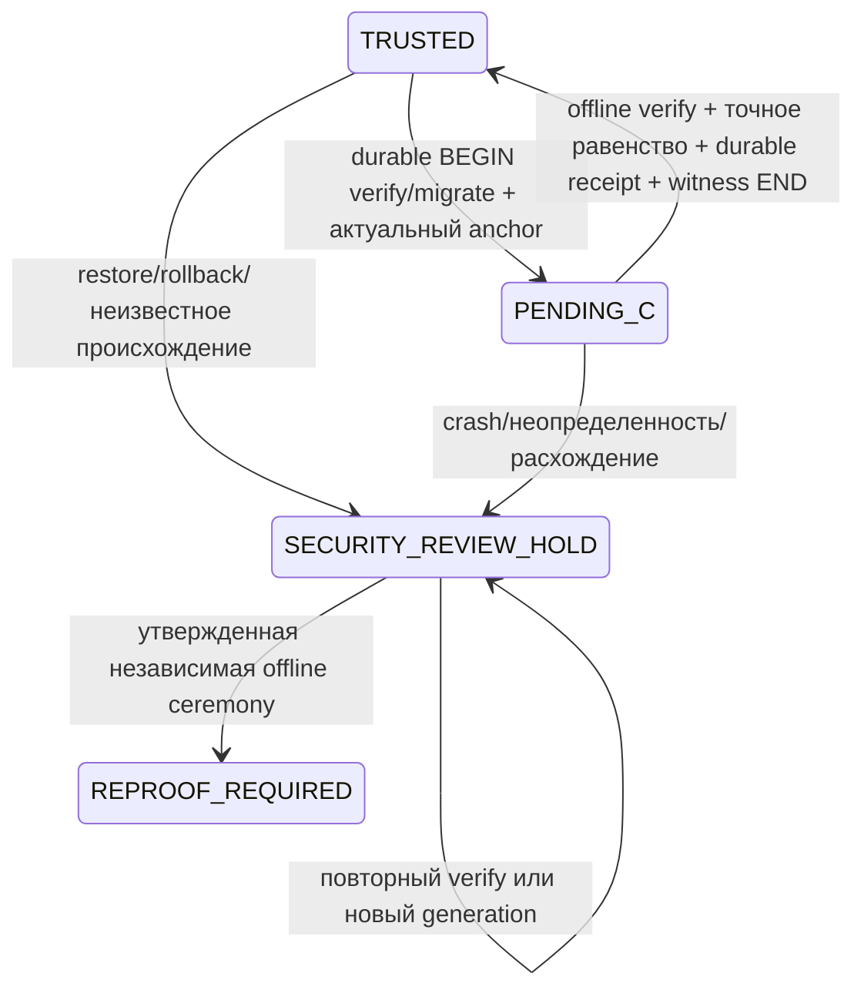

# Clinic Tracker — WP-G Stage 2: финальная архитектура перед реализацией MFA

Дата: 31.10.2026. База: `fd7e6ec784caa1053e2df644ac35eaa9aac8bbc6`.
Статус: **изолированный исследовательский прототип; предложение для независимого ревью, не production MFA**.

## Результат и принятые границы

Основной кандидат — **python-fido2 2.2.1 + отдельный RP-policy adapter**, пароль → ограниченный pre-auth → WebAuthn UV → полноценная сессия. Общая архитектура утверждена для исследования; реализация в Clinic Tracker не разрешена. Три независимо назначенных recovery-оператора, два различных подтверждения, никаких медицинских сессий через recovery. Для первого enrollment/нового фактора обязательны доказательство владения и независимо подтвержденное уведомление. TOTP не добавлен.

Расширение находится в `prototype/final_model.py` и адресных тестах, отдельно от прежнего `Engine`. Это архитектурные компоненты, а не готовый единый auth-сервис. Исходный snapshot v30, production auth.py/security.py/deps.py, WP-F и зависимости приложения не менялись. Ветка/HEAD/refs/origin проверяются по зафиксированным hashes; ни коммитов, ни push.

## C + S1 и происхождение security-state

Подробности: [ADR-MFA-CONTINUITY-002](ADR_SECURITY_CONTINUITY_V2.md).
C возможен только по свидетельству независимого актуального authority, с записанным до начала происхождением операции и доказанно неизменной security-проекцией. Обычный verify, no-op migrate и проверенная миграция могут сохранить trust только после полной процедуры. Любой restore/rollback/неопределенность — SECURITY_REVIEW_HOLD. Повторный verify не снимает hold, новый generation не является доказательством.

Хэш старой базы, подпись старого ledger и восстановленные старые sidecars не доказывают свежесть. Модель держит синтетический current witness вне restore-set, сверяет sequence/digest/generation и запрещает восстановленные revocations/recovery-used/auth_epoch. Внешняя инфраструктура witness **не реализована/не выбрана**. Если witness также откатывается вместе с базой, локального решения нет; до независимого подтверждения действует S1. Предложение требует отдельной версии WP-F, текущий v1 не изменен.

Автоматического перехода из S1 в TRUSTED нет. Подробная crash-матрица и различие rename/fsync — в ADR. Child-process SIGKILL не равен физическому отключению питания; такое испытание не заявляется.

## Recovery, уведомления и угрозы

[Модель трех операторов](RECOVERY_THREE_OPERATORS.md), [контракт уведомлений](INDEPENDENT_NOTIFICATION_CONTRACT.md).

| Угроза | Проверяемое ограничение |
|---|---|
| Один оператор/самовосстановление | Нужны два различных актуальных назначения; цель исключена |
| Старый approval после отзыва | Повторная проверка обоих операторов/epochs под write lock |
| Два/три одновременных approval | Одна атомарная выдача; UNIQUE(case,actor) |
| Crash/audit failure перед grant | Нет grant/epoch change от неполного finalize |
| Отметка «отправлено» вместо доставки | Отдельная receipt и независимый employee ack; иначе hold |
| Подмена/повтор receipt | Привязка к notice/target/event/epoch + уникальность |
| Спор об enrollment/recovery | Epoch изменяется, прежние доказательства теряют силу; hold |
| Потеря двух/всех операторов | Онлайн отказ; отдельная ограниченная offline ceremony |
| Отзыв фактора | Ключ запрещен немедленно; доставка не задерживает отзыв |

Тестовый receipt/удостоверенный principal подаются из доверенной синтетической границы. Это **не** готовая криптографическая проверка реальной независимой доставки. Offline ceremony описана, не реализована как команда удаления hold. До назначения authority и канала эти части остаются блокерами включения, а не поводом ослабить MFA.

## WebAuthn hardening

`Registry` использует отдельный случайный 32-byte user_handle, серверную owner↔credential ID↔key привязку, immutable SQL-ограничения и revoked tombstones. Проверяется корректно подписанный чужой ключ, подмена/тип/null userHandle, неизменность owner/public key/ID/BE/handle, невозможность unrevoke/повторной регистрации известного credential. Один virtual authenticator зарегистрирован в двух синтетических учетных записях: корректные собственные assertions работают, межпользовательская подмена запрещена. Это не доказывает независимость факторов.

Discoverable/resident сценарий требует совпадающий userHandle; non-discoverable explicit credential допускает null при строгом server owner binding. userHandle не входит напрямую в signed authenticatorData, поэтому проверка RP обязательна; `attestation:none` сама по себе не доказывает handle. Crypto не реализована самостоятельно. Исходные проверки challenge/origin/RP/UP/UV/BE/BS/counter/плохой подписи сохранены. Zero/zero допускается по прежней политике, non-increasing positive counter — отказ/risk, не доказательство клонирования. BE неизменяем, BS может изменяться только при валидном BE и успешной подписи.

Нормативная основа: [WebAuthn Level 3, Recommendation](https://www.w3.org/TR/2026/REC-webauthn-3-20260825/), [python-fido2 server API](https://developers.yubico.com/python-fido2/API_Documentation/autoapi/fido2/server/index.html). Предыдущее сравнение двух библиотек остается в WP_G_STAGE2_PROTOTYPE_REPORT.md; кандидат не менялся.

## Доказательства и воспроизведение

В этом расширении добавлены **76 адресных случаев**, суммарно **151 pytest-тест**: исходные 75 и новые 76. Финальный exact-once результат/exit codes/хэши находятся в `evidence/final_architecture/acceptance.json`, `outcomes.json`, `source.json`, `pytest.log`. Эти файлы являются первичным подтверждением завершения, а не числа из ранних development-логов.

Реальный Chromium 153 на localhost с virtual CTAP2 UV authenticators генерирует новые signed response fixtures; private keys не экспортируются. Отдельно повторяется полный живой FastAPI/browser password→preauth→WebAuthn→session→password-change revoke сценарий. Он не является production-интеграцией новых recovery/witness компонентов; эти компоненты проверяются SQLite/pytest/дочерними процессами. Старые 75 Linux-тестов независимо прошли **по сообщению владельца**. Новые тесты здесь выполнены нативно на macOS Python 3.13.4; новый Linux runtime-прогон не заявляется. Safari/Firefox/физические ключи также не заявляются.

После создания отдельного окружения по `requirements-prototype.lock`: `python -m pytest -q -p prototype.outcomes_plugin tests`. Для полного локального acceptance использовать `run_architecture_checks.py` (требует .clean-env, .venv и внешний Playwright/Chromium, как README). Перегенерация hardening fixtures: `node prototype/generate_hardening_vectors.cjs`. Повторные development-запуски не являются retry для обхода падений; финальный frozen набор выполняется однократно с проверкой каждого ID.

## План реализации и решения владельца

Точный последовательный [план v30 → v31](V31_FINAL_IMPLEMENTATION_PLAN.md) уточняет прежний MIGRATION_V31_PLAN.md. Никакого executable DDL для production не создано.

Утверждены для исследования: пароль+WebAuthn UV, отдельный pre-auth, python-fido2 кандидат, два независимо доступных фактора, контролируемый recovery; текущим заданием — исследование C+S1, трех операторов и независимых уведомлений. **Не утверждено автоматическое применение будущего WP-F v2 или включение MFA.**

Требуют решения/инфраструктуры: обязательные роли и rollout/deadlines, реальные HTTPS origin/RP ID (оставлены незаполненными), управляемые устройства/синхронизация и допустимая независимость факторов, три оператора и offline authority, proof-of-identity и независимый канал, retention/security-ledger/witness custody и disaster recovery, RPO/RTO/SLAs, Linux/браузерная/физическая квалификация. C нельзя включать без актуального независимо защищенного witness; иначе S1 с соответствующими затратами RTO. Общий emergency-пароль и MFA-disable флаг запрещены.

Реальные SMS/email/AI не подключались, рабочая база и основной clinic_tracker_new не открывались. Архив передается с исходниками, lock-файлом, тестами и доказательствами; без snapshot vendor-кода, виртуальных окружений, кэшей, wheel/бинарников, временных DB или секретов. Snapshot восстанавливается read-only git archive утвержденного SHA по restore_snapshot.py. После подготовки — остановка для независимого ревью.
